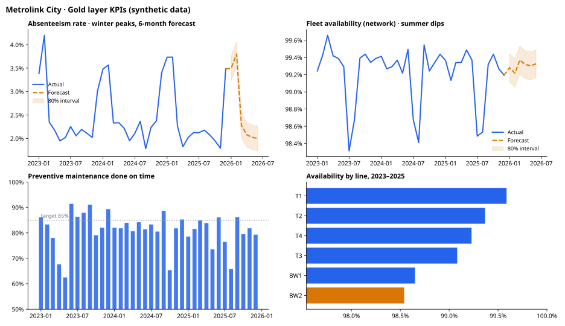
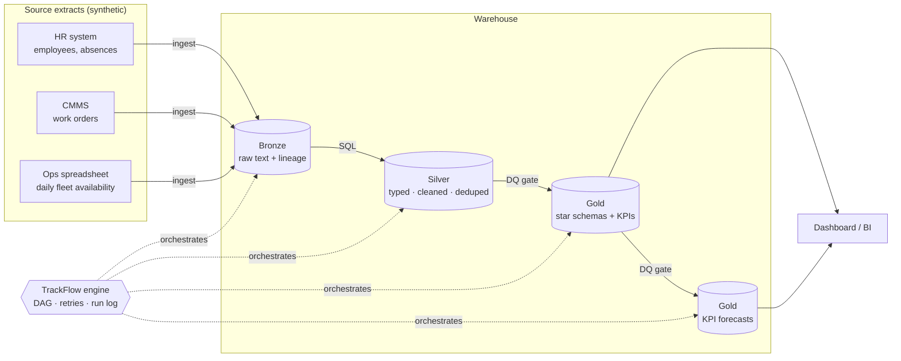
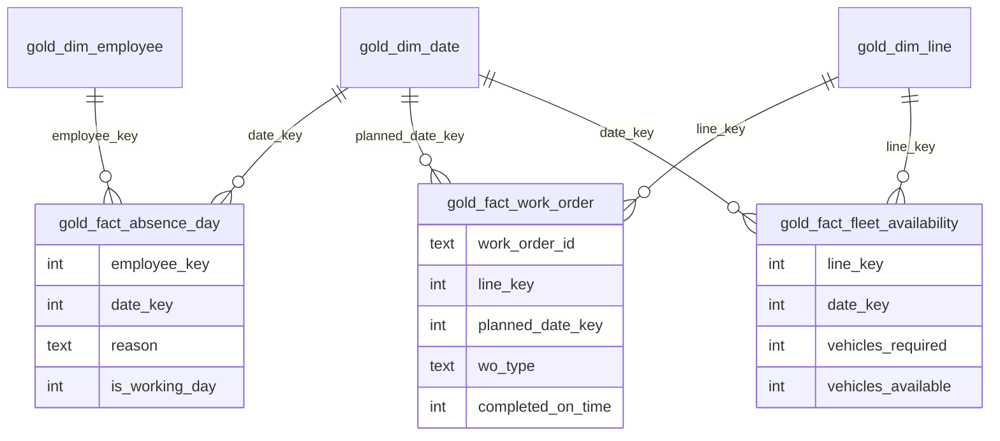

# TrackFlow: a Medallion data platform for transit operations KPIs

[](https://github.com/amiopp/trackflow/actions/workflows/ci.yml)


End-to-end pipeline that turns messy exports from HR, maintenance and operations systems into trusted monthly KPIs for a tram & bus operator: **Bronze → Silver → Gold** in SQL, a config-driven orchestrator with retries and lineage, declarative data quality gates, back-tested forecasts written back to the warehouse, and a monitoring dashboard.

It is a public, synthetic-data rebuild of the platform I delivered as a Data Engineering intern at **RATP Dev Casablanca** (Casablanca tramway & busway), where it replaced a manual Excel KPI process. The company version ran on SQL Server, Power BI and Prophet and is private. This one runs anywhere with one command.



---

## Quick start

```bash
docker compose up            # generates data, builds the warehouse, serves the dashboard on :5000
```

or locally:

```bash
pip install -e ".[dev]"
make data run                # synthetic extracts -> full pipeline run (~2 s)
python -m trackflow.cli kpis # latest KPI snapshot
make serve                   # dashboard on http://127.0.0.1:5000
make test lint
```

```text
05:12:51 INFO    run 20261120T051251-567951 started: 14 task(s) [all]
05:12:51 INFO      ingest_hr_absences           ok      0.02s 8,479 rows
05:12:51 INFO      silver_absences              ok      0.03s
05:12:51 INFO      dq_silver                    ok      0.00s 8 checks passed
05:12:52 INFO      gold_kpis                    ok      0.05s
05:12:52 INFO      forecast_kpis                ok      0.65s 18 rows written
05:12:52 INFO    run 20261120T051251-567951 finished: SUCCESS
```

---

## Architecture



| Layer | What happens | Where |
|---|---|---|
| **Bronze** | Files landed untouched, every column as text, plus `_batch_id`, `_source_file`, `_ingested_at` | [`ingest.py`](trackflow/ingest.py) |
| **Silver** | Three date formats parsed, casing and whitespace normalised, duplicates removed, orphans and impossible records dropped | [`sql/silver/`](sql/silver) |
| **Gold** | Conformed dimensions, facts at a declared grain, a long-format monthly KPI table | [`sql/gold/`](sql/gold) |
| **Forecast** | 6-month predictions with 80 % intervals, back-tested before being written | [`forecast.py`](trackflow/forecast.py) |

### Data model (Gold)



KPIs live in `gold_kpi_monthly (kpi, scope, year_month, value, numerator, denominator)`. Storing numerator and denominator means ratios can be re-aggregated correctly (network availability is weighted by required fleet, not an average of line percentages), and adding a KPI never needs a schema change.

| KPI | Definition |
|---|---|
| Absenteeism rate | absent working days ÷ (headcount × working days), by department and overall |
| Turnover rate | exits in month ÷ headcount at start of month |
| Preventive maintenance compliance | preventive work orders closed within 3 days of plan ÷ planned |
| Fleet availability | vehicles available ÷ vehicles required, per line and network |

---

## Orchestration

Pipelines are declared in [`pipelines.yaml`](pipelines.yaml). Adding a source or model is one entry, not new orchestration code.

```yaml
- { name: silver_absences, layer: silver, type: sql, file: sql/silver/absences.sql,
    depends_on: [ingest_hr_absences, silver_employees] }
```

The [engine](trackflow/engine.py):

- **validates the DAG** before running anything (unknown dependencies, cycles) and executes in topological order
- **retries** failed tasks with exponential backoff (2 s → 4 s → 8 s). Data quality failures are *not* retried, because they are deterministic
- **stops bad data spreading**: everything downstream of a failure is marked `skipped`, not run on partial inputs
- **reruns partially**: `--from-layer gold` rebuilds Gold only, and `--only silver_absences` reruns one model plus everything that depends on it
- **records lineage and history** in `ops_runs`, `ops_task_runs` (every attempt, duration, rows, error) and `ops_dq_results`

```bash
python -m trackflow.cli plan                  # print execution order
python -m trackflow.cli run --from-layer gold
python -m trackflow.cli run --only silver_absences
```

## Data quality

Checks are declared next to the tasks they guard and compile to SQL that counts failing rows: `not_null`, `unique`, `accepted_values`, `relationship`, `expression`, `min_rows`. Each check has a severity. `error` blocks the layer above, and `warn` is logged and surfaced on the dashboard.

```yaml
- { table: gold_fact_absence_day, check: relationship, column: employee_key, to: gold_dim_employee, to_column: employee_key }
- { table: gold_kpi_monthly, check: expression, expr: "kpi <> 'fleet_availability' OR value >= 0.80", severity: warn }
```

The generator deliberately injects the problems real exports have (duplicate rows, `dd/mm/yyyy` mixed with ISO and `yyyymmdd`, inconsistent casing, blank dates, orphan foreign keys), and the tests assert that Silver removes exactly those.

> **A bug the tests caught.** SQLite's `DATE('2024-02-31')` silently returns `2024-03-02`. An invalid date in a source file would have become a real, wrong absence day. The date macro now only accepts a value that `DATE()` returns unchanged, and the case is pinned by a test.

## Forecasting

Each KPI gets a linear trend + month-of-year seasonality model (OLS) with an 80 % interval from the residual spread. Before the forecast is written, the model is back-tested on the last 6 months against a seasonal-naive baseline (same month last year), and both errors are stored in `gold_kpi_forecast_eval`:

| KPI | MAE model | MAE seasonal naive | Improvement |
|---|---|---|---|
| Fleet availability | 0.087 pp | 0.177 pp | **51 %** |
| Absenteeism rate | 0.179 pp | 0.241 pp | **25 %** |
| Turnover rate | 0.109 pp | 0.115 pp | 5 % |

Turnover barely beats the baseline because monthly exits are small, noisy counts. That's useful to know before anyone plans around the forecast. The production version used Prophet. Here I chose a small, explainable model with no heavy dependencies, held to the same back-testing bar.

## Dashboard

`make serve` starts a Flask app over the warehouse and the run log: run history and success rate, per-task status, attempts and durations, data quality results, KPI actuals with forecast bands, and a button to trigger full or partial reruns (guarded so two runs can't overlap). JSON endpoints: `/api/runs`, `/api/runs/<id>`, `/api/stats`, `/api/kpis`, `/api/pipeline`, `POST /api/run`.

## Testing & CI

26 tests across three files:

- **Engine**: DAG ordering, cycle detection, layer and task selection, backoff timings, downstream skipping, no retries on DQ failures
- **Transformations**: every date format, deduplication, orphan removal, fact grain, KPI reconciliation (`value = numerator / denominator`), weighted network availability, complete monthly coverage
- **Forecast & API**: the model recovers a known trend and seasonality exactly, forecasts are bounded and back-tested, and dashboard endpoints work

GitHub Actions runs ruff, the tests on Python 3.10 and 3.12, and a full end-to-end pipeline run on every push.

## Design decisions

- **SQL for transformations, Python for movement.** Set-based logic stays declarative and reviewable, as stored procedures were in production.
- **Bronze is text-only and append-friendly.** Nothing is lost at ingestion, so Silver can always be rebuilt when cleaning rules change.
- **Long-format KPI table with numerator/denominator.** It is correct under re-aggregation and keeps the schema stable as KPIs are added.
- **SQLite as the default engine.** Anyone can clone and run the project in seconds. The SQL avoids engine-specific features apart from date functions (isolated in one macro), so porting to SQL Server or Postgres means swapping the connection and that macro.

## Project layout

```text
trackflow/   engine.py · ingest.py · quality.py · forecast.py · sql.py · dashboard.py · cli.py · generate.py
sql/         silver/*.sql · gold/*.sql        (Jinja-templated, one model per file)
tests/       engine · transformations · forecast & API
docs/        README chart + script to regenerate it
pipelines.yaml   the whole pipeline: tasks, dependencies, checks, retry policy
```

## Roadmap

- Incremental Silver loads keyed on `_batch_id` instead of full rebuilds
- Postgres target behind a connection setting, with the same test suite run against both
- Department-level forecasts and alerting when actuals leave the forecast interval

---

Built by [Mohamed Amine Adnane](https://github.com/amiopp) · Data Engineer · BI Developer · [LinkedIn](https://linkedin.com/in/mohamed-amine-adnane-57097038a)
